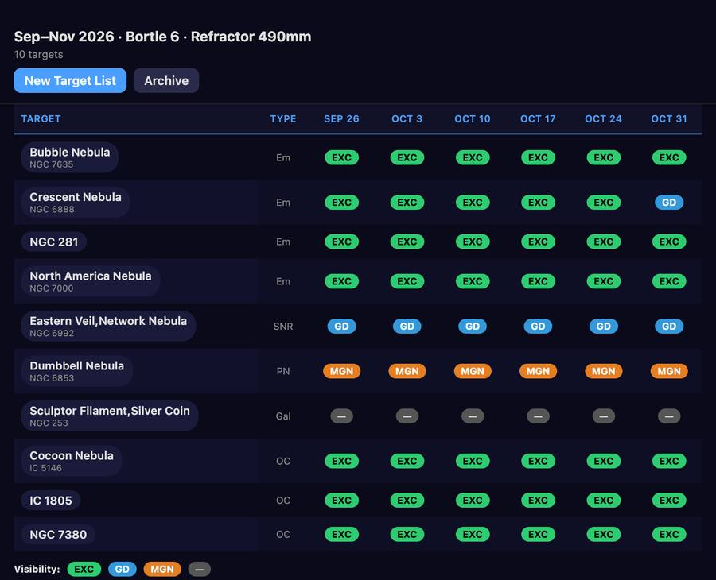
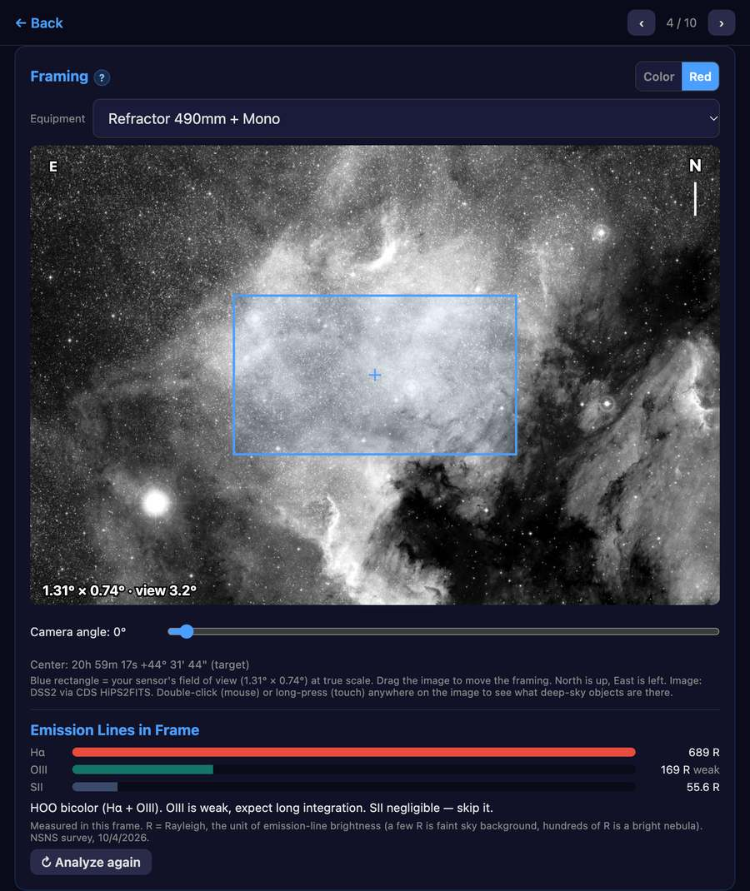

# Smart Astro Planner

**Live app: https://crepusculum.space/smart-astro-planner/**

A free, single-file progressive web app (PWA) for astrophotography planning. It answers
*"what are my options over the next few weeks?"* from an amateur's backyard — partial horizon, few clear
nights, limited hours per target — using a local catalog of 19,092 deep-sky objects, real sky images for
framing, and (optionally) the Claude API for descriptions and capture advice.

It is a planning aid, not a replacement for tools like Telescopius or SkySafari: validate a target there
before committing several nights to it.




*Sky images: Digitized Sky Survey (STScI/NASA) via CDS — see [THIRD-PARTY-NOTICES.md](THIRD-PARTY-NOTICES.md).*

## What it does

- **Target search** from the local catalog (galaxies, nebulae, clusters, supernova remnants…), by type, site
  and period, rated week by week by the **usable hours** per night — with your minimum altitude and a
  **horizon mask** (the directions your house or trees block).
- **Framing**: your sensor's field of view at true scale on a real sky image (DSS2), with camera angle,
  equipment choice, and an **on-demand** mode that downloads nothing until you ask.
- **What's in my Frame?**: double-click or long-press the image to list the deep-sky objects at that spot.
- **Emission Lines in Frame**: measures Hα, OIII and SII in your frame to suggest LRGB, HOO or SHO.
- **Altitude Profile** with the Moon's distance, and badges telling which of your filters the Moon leaves
  usable that night; **Best Season** by month.
- **My Targets**: saved framings, each fixed to an equipment and an observing site. **Night Info**: transit
  time and dark hours, e.g. to check a meridian flip.
- **Optional AI** (your own Anthropic API key, or copy-and-paste with any LLM): object descriptions and
  capture advice. Target selection is never AI.
- **Backup & Sync** between devices with a JSON file. Works offline once loaded (the catalog and all the
  calculations are stored with the app).

The in-app **Help** has the full guide and a Change Log.

## Privacy

There are no accounts, no analytics and no tracking. Your locations, equipment, targets and preferences
stay in your browser's storage on your own device, and so does your API key. The app talks only to: the
CDS services (sky images and narrowband data via HiPS2FITS, object identifications via SIMBAD), Wikipedia
(optional summaries), and the Anthropic API (optional, with your key). The server that hosts the app may keep
ordinary access logs.

## Run it locally

```
python3 -m http.server 8080
```

Then open http://localhost:8080. Do not open `index.html` through `file://` (the catalog fetch and the
service worker need HTTP).

## Host your own copy

It is a static site: no build step, no framework, no server code. Put these files on any web host that
serves HTTPS (a service worker needs it, except on localhost):

`index.html`, `sw.js`, `manifest.json`, `catalog.json`, `help.html`, `help-img/`, `icon-192.png`,
`icon-512.png`, `astronomy.browser.min.js` and `CLAUDE.md` (the Ask AI box reads it as extra context).
`.htaccess` is optional and only for Apache or LiteSpeed hosts: it keeps `sw.js` from being cached and
compresses the catalog. The app works from any folder (`start_url` is relative).

Whenever you change a file, bump `CACHE_NAME` in `sw.js` or installed copies will not update. If you reuse
the service of the CDS, please keep it gentle: the app asks for one image at a time, and so should a fork.

## Forking and credit

Forks, changes and republishing are welcome, under the terms below. In short: **credit Crepusculum, say
what you changed, keep the same license, and stay non-commercial.** A line like

> *Based on Smart Astro Planner by Crepusculum (crepusculum.space)*

in your README and in your app's About section satisfies the credit requirement. Please also keep
[THIRD-PARTY-NOTICES.md](THIRD-PARTY-NOTICES.md) and the acknowledgements in the app: the permission to
use the DSS2 sky images and the narrowband survey is itself limited to non-commercial use.

## Contributing

Bug reports, ideas and pull requests are welcome through GitHub Issues and Pull Requests. By contributing
you agree that your contribution is licensed under the same terms as the part of the project it changes
(CC BY-NC-SA 4.0 for the code and documentation, CC BY-SA 4.0 for the catalog). Design decisions and their
history are written down in [CLAUDE.md](CLAUDE.md); please read it before proposing a change to how a feature
works.

## License

Copyright (c) 2026 Crepusculum.

- **Code, help, icons and screenshots** — [CC BY-NC-SA 4.0](LICENSE). You may copy, fork, modify and
  publish it, but you must credit Crepusculum, indicate your changes, keep the same license, and not use
  it commercially.
- **`catalog.json`** — [CC BY-SA 4.0](LICENSE-CATALOG), because it is derived from
  [OpenNGC](https://github.com/mattiaverga/OpenNGC).
- **Third-party material** — see [THIRD-PARTY-NOTICES.md](THIRD-PARTY-NOTICES.md).
